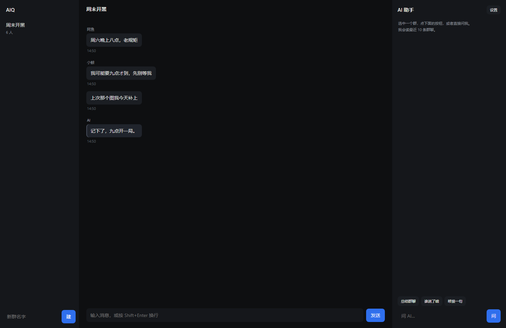

# AIQ

自托管的聊天软件 + 内置 AI。数据全在自己机器上，AI 用你自己的 Key。



> 做这个的原因：现有 IM 要么替你想好一切（人格、限流、审核），要么根本不让你接自己的模型。
> AIQ 反过来——**服务器你自己开，人格你自己定，模型 Key 你自己填**。

## 现在的样子（v0.1）

- 群聊：建群、凭邀请码加群、实时收发（WebSocket）、断线按 seq 补拉离线消息
- 本地存储：SQLite（`node:sqlite`），记录不出本机
- AI 侧边栏：填自己的 DeepSeek（或任何 OpenAI 兼容接口）Key，读群聊上下文回答问题
- `/ai 这句话`：不发给群友，转给模型，回答以「AI 助手」身份发进群
- 插件：`plugins/<id>/` 放一个 `manifest.json` + `index.js` 就生效，权限白名单三选
- 局域网：服务监听 `0.0.0.0`，同一 WiFi 下别人用浏览器打开 `http://你的内网IP:8090` 即可进同一个群

## 谁能看到谁

这里没有「注册即信任」：

| 边界 | 规则 |
|---|---|
| 群列表 | 只返回你自己加入过的群 |
| 读历史 / 发言 | 不在群里 → 403（HTTP 和 WebSocket 都一样） |
| 加群 | 必须凭群主的 6 位邀请码，没码加不进去 |
| AI Key | 按用户各存一份，别人用不了你的额度 |
| 机器人 token | 没配就随机生成，落在 `data/bot-token.txt` |

建群后左侧列表会显示你的邀请码，发给朋友就能进。

## 跑起来

```bash
npm install
npm start          # 只跑服务端 -> http://127.0.0.1:8090
npm run dev        # Electron 窗口
```

> Windows 上 Electron 若一启动就崩（0x80000003），是沙箱问题，用 `--no-sandbox` 启动：
> `node_modules\electron\dist\electron.exe . --no-sandbox`

## 插件

```
plugins/hello-fish/
├── manifest.json   # id / name / version / permissions
└── index.js        # 导出 onMessage(msg, api)
```

权限只有三种，按需申请：

| 权限 | 拿到什么 |
|---|---|
| `read_context` | `api.getContext(n)` 最近 n 条消息 |
| `send_message` | `api.send(text)` 以插件身份发言 |
| `call_llm` | `api.llm(prompt)` 调你配的模型 |

⚠️ **插件跑在独立子进程里**：启动时带 Node 权限模型（`--permission`），只允许读自己的插件目录——
没有网络、不能起子进程、读不到你机器上的其他文件。想要能力，只能通过上面三种 API 向主进程申请。

插件崩了或卡住超过 8 秒会被杀掉重启，最多重试 5 次，不会拖垮服务器。

## 接口

| 方法 | 路径 | 说明 |
|---|---|---|
| POST | `/api/register` | 起名注册，返回 token |
| POST | `/api/login` | token 换用户 |
| GET | `/api/groups` | 群列表 |
| POST | `/api/groups` | 建群 |
| GET | `/api/history?groupId&since` | 拉历史 / 补拉 |
| POST | `/api/send` | 发消息 |
| POST | `/api/ai` | 问 AI（带群聊上下文） |
| POST | `/api/ai/say` | 让 AI 以「AI 助手」身份发进群 |
| POST | `/api/bot/send` | 外部机器人发言（需 BOT_TOKEN） |
| GET | `/api/net` | 本机局域网地址 |

WebSocket：`/ws?token=...`，发 `{type:'join'|'send'}`。

## 路线

v0.2 已完成（插件沙箱）。接下来：

- [ ] **多端同步**：手机/网页进来看到同一份消息
- [ ] **消息里的文件**（图片、文档），先存本地再走 WebSocket 分发

往后：

- [x] 本地存储 + 群聊 + 断线补拉
- [x] AI 侧边栏（BYOK）+ `/ai` 指令
- [x] 插件机制（清单 + 权限白名单）
- [x] 插件真沙箱（子进程 + Node `--permission`）
- [x] 局域网多端
- [x] 群成员边界 + 邀请码
- [ ] OneBot v11 兼容（把现成 QQ 机器人生态接进来）
- [ ] 自建服务器互联（几个小服务器互相联邦）

## 许可

AGPL-3.0。你可以随便用、改、自己部署；但如果改完拿去对外提供网络服务，必须把改过的源码也开源。
商业闭源要授权，单独找我谈。
